# Diagrama de Classes — Arquitetura Completa

Visão consolidada da arquitetura da API Soromaps, estruturada em camadas estritas e orientada a contratos, em estrita conformidade com o **ADR-0003 (Arquitetura em Camadas por Tipo e Padronização de Responsabilidades)**.

## Visão Geral da Arquitetura

1. **Camada HTTP (`Controllers`):**
   - Herdam de `ApiControllerBase`.
   - Responsáveis unicamente pelo protocolo HTTP (roteamento, status codes, cabeçalhos, extração de parâmetros e claims de autenticação).
   - Não acessam o banco de dados diretamente; delegam integralmente para contratos de serviço (`ISomeService`).
   - Traduzem os resultados operacionais (`Result` / `Result<T>`) para respostas padronizadas `ProblemDetails` via método centralizado `Problem(Error)`.

2. **Camada de Aplicação e Negócio (`Services`):**
   - Implementam as interfaces de negócio (`IPlaceService`, `IAuthService`, etc.).
   - Injetam e utilizam diretamente o `AppDbContext`, que atua como Unidade de Trabalho e Repositório (padrão oficial Microsoft para EF Core).
   - Injetam contexto do usuário atual (`ICurrentUserService`) para prevenção sistemática de vulnerabilidades IDOR.
   - Retornam tipos monetários/funcionais explícitos (`Result`, `Result<TValue>`) com erros tipados (`ErrorType`), evitando exceções de fluxo de controle.

3. **Camada de Projeção e Mapeamento (`Mappings`):**
   - Classes e expressões estáticas (`Expression<Func<TEntity, TDto>>`) que garantem projeções SQL otimizadas (`SELECT` contendo apenas as colunas consumidas pelos contratos).

4. **Camada de Dados e Domínio (`Data` e `Models`):**
   - Entidades de domínio implementando `IAuditableEntity` com identificadores UUID ou BigInt.

```mermaid
classDiagram
    direction TB

    namespace Controllers {
        class ApiControllerBase {
            <<abstract>>
            #Problem(Error error) IActionResult
        }

        class PlacesController {
            -IPlaceService _placeService
            +GetPlaces(PlaceFilterDto filter) Task~IActionResult~
            +GetById(Guid id) Task~IActionResult~
            +Create(CreatePlaceDto dto) Task~IActionResult~
            +Update(Guid id, UpdatePlaceDto dto) Task~IActionResult~
            +Delete(Guid id) Task~IActionResult~
        }

        class AuthController {
            -IAuthService _authService
            +Login(LoginDto dto) Task~IActionResult~
            +Refresh(RefreshTokenDto dto) Task~IActionResult~
            +Logout() Task~IActionResult~
            +RevokeAllSessions() Task~IActionResult~
        }

        class ReviewsController {
            -IReviewService _reviewService
            +GetByPlace(Guid placeId) Task~IActionResult~
            +Create(Guid placeId, CreateReviewDto dto) Task~IActionResult~
            +Update(Guid id, UpdateReviewDto dto) Task~IActionResult~
            +VoteUseful(Guid id) Task~IActionResult~
        }

        class StoriesController {
            -IStoryService _storyService
            +GetStories(StoryFilterDto filter) Task~IActionResult~
            +GetBySlug(string slug) Task~IActionResult~
            +Create(CreateStoryDto dto) Task~IActionResult~
            +Publish(Guid id) Task~IActionResult~
        }

        class AdminDashboardController {
            -IAdminDashboardService _dashboardService
            +GetMetrics() Task~IActionResult~
            +GetSummary() Task~IActionResult~
        }
    }

    namespace Services {
        class IPlaceService {
            <<interface>>
            +GetPlacesAsync(PlaceFilterDto filter) Task~Result~PagedResult~PlaceResponseDto~~~
            +GetByIdAsync(Guid id) Task~Result~PlaceDetailResponseDto~~
            +CreateAsync(CreatePlaceDto dto) Task~Result~PlaceResponseDto~~
            +UpdateAsync(Guid id, UpdatePlaceDto dto) Task~Result~PlaceResponseDto~~
            +DeleteAsync(Guid id) Task~Result~
        }

        class PlaceService {
            -AppDbContext _context
            -ICurrentUserService _currentUser
            -ISupabaseStorageService _storageService
            +GetPlacesAsync(PlaceFilterDto filter) Task~Result~PagedResult~PlaceResponseDto~~~
            +GetByIdAsync(Guid id) Task~Result~PlaceDetailResponseDto~~
            +CreateAsync(CreatePlaceDto dto) Task~Result~PlaceResponseDto~~
        }

        class IAuthService {
            <<interface>>
            +LoginAsync(LoginDto dto) Task~Result~AuthResponseDto~~
            +RefreshTokenAsync(RefreshTokenDto dto) Task~Result~AuthResponseDto~~
            +LogoutAsync() Task~Result~
            +RevokeAllSessionsAsync() Task~Result~
        }

        class AuthService {
            -AppDbContext _context
            -ITokenService _tokenService
            -ICurrentUserService _currentUser
            +LoginAsync(LoginDto dto) Task~Result~AuthResponseDto~~
            +RefreshTokenAsync(RefreshTokenDto dto) Task~Result~AuthResponseDto~~
        }

        class IReviewService {
            <<interface>>
            +GetByPlaceAsync(Guid placeId) Task~Result~List~ReviewResponseDto~~~
            +CreateAsync(Guid placeId, CreateReviewDto dto) Task~Result~ReviewResponseDto~~
            +ToggleUsefulVoteAsync(Guid reviewId) Task~Result~bool~~
        }

        class ReviewService {
            -AppDbContext _context
            -ICurrentUserService _currentUser
            -IAchievementEvaluatorService _achievementEvaluator
            +GetByPlaceAsync(Guid placeId) Task~Result~List~ReviewResponseDto~~~
            +CreateAsync(Guid placeId, CreateReviewDto dto) Task~Result~ReviewResponseDto~~
        }

        class IStoryService {
            <<interface>>
            +GetPublishedStoriesAsync(StoryFilterDto filter) Task~Result~List~StoryResponseDto~~~
            +GetBySlugAsync(string slug) Task~Result~StoryDetailResponseDto~~
            +CreateAsync(CreateStoryDto dto) Task~Result~StoryDetailResponseDto~~
            +PublishAsync(Guid id) Task~Result~
        }

        class StoryService {
            -AppDbContext _context
            -ICurrentUserService _currentUser
            +GetPublishedStoriesAsync(StoryFilterDto filter) Task~Result~List~StoryResponseDto~~~
            +GetBySlugAsync(string slug) Task~Result~StoryDetailResponseDto~~
        }

        class IAdminDashboardService {
            <<interface>>
            +GetSummaryMetricsAsync() Task~Result~DashboardMetricsResponseDto~~
        }

        class AdminDashboardService {
            -AppDbContext _context
            +GetSummaryMetricsAsync() Task~Result~DashboardMetricsResponseDto~~
        }

        class ICurrentUserService {
            <<interface>>
            +UserId Guid?
            +Role UserRole?
            +IsAuthenticated bool
        }
    }

    namespace Results_And_Errors {
        class Result~TValue~ {
            +bool IsSuccess
            +bool IsFailure
            +TValue Value
            +Error Error
            +Success(TValue value)$ Result~TValue~
            +Failure(Error error)$ Result~TValue~
        }

        class Result {
            +bool IsSuccess
            +bool IsFailure
            +Error Error
            +Success()$ Result
            +Failure(Error error)$ Result
        }

        class Error {
            +string Code
            +string Description
            +ErrorType Type
            +Validation(string code, string desc)$ Error
            +NotFound(string code, string desc)$ Error
            +Conflict(string code, string desc)$ Error
            +Unauthorized(string code, string desc)$ Error
            +Forbidden(string code, string desc)$ Error
        }

        class ErrorType {
            <<enumeration>>
            Validation
            NotFound
            Conflict
            Unauthorized
            Forbidden
        }
    }

    namespace Data {
        class AppDbContext {
            +DbSet~User~ Users
            +DbSet~Session~ Sessions
            +DbSet~Category~ Categories
            +DbSet~Place~ Places
            +DbSet~PlacePhoto~ PlacePhotos
            +DbSet~Tag~ Tags
            +DbSet~PlaceTag~ PlaceTags
            +DbSet~ModerationDecision~ ModerationDecisions
            +DbSet~Review~ Reviews
            +DbSet~Comment~ Comments
            +DbSet~ReviewUsefulVote~ ReviewUsefulVotes
            +DbSet~ContentRemoval~ ContentRemovals
            +DbSet~Visit~ Visits
            +DbSet~Favorite~ Favorites
            +DbSet~Achievement~ Achievements
            +DbSet~UserAchievement~ UserAchievements
            +DbSet~Report~ Reports
            +DbSet~Feedback~ Feedbacks
            +DbSet~Story~ Stories
            +DbSet~StoryPlace~ StoryPlaces
            +DbSet~FeedMute~ FeedMutes
            +SaveChangesAsync(CancellationToken cancellationToken) Task~int~
        }
    }

    namespace Models {
        class IAuditableEntity {
            <<interface>>
            +DateTime CreatedAt
            +DateTime UpdatedAt
        }

        class User {
            +Guid Id
            +string Name
            +string Email
            +UserRole Role
            +string? AvatarUrl
            +string? Biography
            +string? Neighborhood
            +DateTime CreatedAt
            +DateTime UpdatedAt
        }

        class Place {
            +Guid Id
            +Guid CategoryId
            +Guid? AuthorId
            +string Name
            +double Latitude
            +double Longitude
            +string Neighborhood
            +PlaceStatus Status
            +DateTime CreatedAt
            +DateTime UpdatedAt
        }

        class Review {
            +Guid Id
            +Guid PlaceId
            +Guid? UserId
            +string Content
            +int Rating
            +DateTime? RemovedAt
            +DateTime CreatedAt
            +DateTime UpdatedAt
        }

        class Story {
            +Guid Id
            +string Slug
            +string Title
            +string Subtitle
            +StoryStatus Status
            +Guid AuthorId
            +DateTime? PublishedAt
            +DateTime CreatedAt
            +DateTime UpdatedAt
        }

        class Achievement {
            +Guid Id
            +string Name
            +string Description
            +AchievementEventType EventType
            +int RequiredQuantity
            +bool IsActive
        }
    }

    namespace Mappings {
        class PlaceMappings {
            +ToSummaryDto() Expression
            +ToDetailDto() Expression
        }
        class ReviewMappings {
            +ToResponseDto() Expression
        }
        class StoryMappings {
            +ToSummaryDto() Expression
            +ToDetailDto() Expression
        }
    }

    %% Relações de Herança
    ApiControllerBase <|-- PlacesController
    ApiControllerBase <|-- AuthController
    ApiControllerBase <|-- ReviewsController
    ApiControllerBase <|-- StoriesController
    ApiControllerBase <|-- AdminDashboardController

    %% Delegação Controller -> Service Interfaces
    PlacesController --> IPlaceService : "delega operação"
    AuthController --> IAuthService : "delega operação"
    ReviewsController --> IReviewService : "delega operação"
    StoriesController --> IStoryService : "delega operação"
    AdminDashboardController --> IAdminDashboardService : "delega operação"

    %% Implementação de Interfaces pelos Services
    PlaceService ..|> IPlaceService
    AuthService ..|> IAuthService
    ReviewService ..|> IReviewService
    StoryService ..|> IStoryService
    AdminDashboardService ..|> IAdminDashboardService

    %% Acesso a Dados: Services injetam DbContext e Dependências
    PlaceService --> AppDbContext : "opera dados"
    PlaceService --> ICurrentUserService : "valida contexto de autor"
    AuthService --> AppDbContext : "opera dados"
    ReviewService --> AppDbContext : "opera dados"
    StoryService --> AppDbContext : "opera dados"
    AdminDashboardService --> AppDbContext : "agrega métricas"

    %% Projeções e Retorno Funcional
    PlaceService ..> PlaceMappings : "projeta consultas SQL"
    PlaceService ..> Result~TValue~ : "retorna resposta"
    ReviewService ..> Result~TValue~ : "retorna resposta"
    AuthService ..> Result~TValue~ : "retorna resposta"
    Result~TValue~ --> Error : "contém se falha"
    Error --> ErrorType : "classifica"

    %% DbContext gerencia Entidades de Domínio
    AppDbContext o-- User
    AppDbContext o-- Place
    AppDbContext o-- Review
    AppDbContext o-- Story
    AppDbContext o-- Achievement

    %% Entidades que implementam auditoria
    User ..|> IAuditableEntity
    Place ..|> IAuditableEntity
    Review ..|> IAuditableEntity
    Story ..|> IAuditableEntity
    Achievement ..|> IAuditableEntity
```

   - `AppDbContext` configurado via `IEntityTypeConfiguration<T>` isoladas por entidade, garantindo integridade e índices de alta performance.

