# Diagrama Entidade-Relacionamento (DER) — Modelo Completo

Modelo lógico e relacional do banco de dados PostgreSQL (`public`) do Soromaps API, contemplando todas as 21 tabelas do sistema, seus relacionamentos, tipos reais de dados e regras de integridade referencial.

```mermaid
erDiagram
    %% Identidade e Autenticação
    tb_users ||--o{ tb_sessions : "autentica"

    %% Catálogo de Lugares e Tags
    tb_categories ||--o{ tb_places : "classifica"
    tb_users ||--o{ tb_places : "cadastra"
    tb_places ||--o{ tb_place_photos : "contem"
    tb_users ||--o{ tb_place_photos : "faz upload"
    tb_places ||--o{ tb_place_tags : "possui"
    tb_tags ||--o{ tb_place_tags : "associa"

    %% Moderação e Auditoria de Lugares
    tb_places ||--o{ tb_moderation_decisions : "recebe auditoria"
    tb_users ||--o{ tb_moderation_decisions : "aplica moderacao"

    %% Avaliações e Comentários Comunitários
    tb_places ||--o{ tb_reviews : "recebe avaliacao"
    tb_users ||--o{ tb_reviews : "avalia"
    tb_reviews ||--o{ tb_comments : "recebe comentario"
    tb_users ||--o{ tb_comments : "comenta"
    tb_comments ||--o{ tb_comments : "responde"
    tb_reviews ||--o{ tb_review_useful_votes : "recebe voto"
    tb_users ||--o{ tb_review_useful_votes : "vota util"

    %% Auditoria de Conteúdo Removido
    tb_users ||--o{ tb_content_removals : "autor do conteudo"
    tb_users ||--o{ tb_content_removals : "moderador que removeu"

    %% Atividades do Explorador (Visitas e Favoritos)
    tb_users ||--o{ tb_visits : "registra visita"
    tb_places ||--o{ tb_visits : "visitado em"
    tb_users ||--o{ tb_favorites : "favorita"
    tb_places ||--o{ tb_favorites : "favoritado por"

    %% Gamificação e Conquistas
    tb_achievements ||--o{ tb_user_achievements : "concede"
    tb_users ||--o{ tb_user_achievements : "desbloqueia"

    %% Governança, Denúncias e Feedbacks
    tb_users ||--o{ tb_reports : "denuncia"
    tb_users ||--o{ tb_reports : "resolve denuncia"
    tb_users ||--o{ tb_feedback : "envia feedback"

    %% Editorial, Pautas (Stories) e Feed
    tb_users ||--o{ tb_stories : "cria pauta"
    tb_stories ||--o{ tb_story_places : "contem local"
    tb_places ||--o{ tb_story_places : "destacado em"
    tb_users ||--o{ tb_feed_mutes : "silencia escopo"

    tb_users {
        uuid id PK
        varchar(100) name
        varchar(255) email UK
        text password_hash
        varchar(20) role
        varchar(500) avatar_url
        varchar(280) biography
        varchar(60) neighborhood
        timestamptz created_at
        timestamptz updated_at
    }

    tb_sessions {
        bigint id PK
        uuid user_id FK
        char(64) token_hash UK
        timestamptz expires_at
        timestamptz revoked_at
        varchar(300) user_agent
        timestamptz created_at
    }

    tb_categories {
        uuid id PK
        varchar(60) name UK
        varchar(60) slug UK
        varchar(40) icon
        varchar(7) color
        smallint sort_order
        boolean is_active
        timestamptz created_at
        timestamptz updated_at
    }

    tb_places {
        uuid id PK
        uuid category_id FK
        uuid author_id FK
        varchar(120) name
        double_precision latitude
        double_precision longitude
        varchar(60) neighborhood
        varchar(280) about
        varchar(2000) description
        boolean has_wifi
        boolean is_pet_friendly
        varchar(100) best_time
        varchar(300) local_secret
        varchar(20) status
        timestamptz created_at
        timestamptz updated_at
    }

    tb_place_photos {
        uuid id PK
        uuid place_id FK
        uuid uploaded_by_id FK
        varchar(600) url
        varchar(300) storage_path
        boolean is_cover
        timestamptz created_at
    }

    tb_tags {
        uuid id PK
        varchar(50) name UK
        varchar(60) slug UK
        timestamptz created_at
    }

    tb_place_tags {
        uuid place_id PK,FK
        uuid tag_id PK,FK
    }

    tb_moderation_decisions {
        uuid id PK
        uuid place_id FK
        uuid moderator_id FK
        varchar(20) previous_status
        varchar(20) decision
        varchar(50) reason
        varchar(500) feedback_note
        boolean is_undo
        timestamptz created_at
    }

    tb_reviews {
        uuid id PK
        uuid place_id FK
        uuid user_id FK
        varchar(2000) content
        integer rating
        timestamptz removed_at
        timestamptz created_at
        timestamptz updated_at
    }

    tb_comments {
        uuid id PK
        uuid review_id FK
        uuid user_id FK
        uuid reply_to_id FK
        varchar(1000) content
        timestamptz removed_at
        timestamptz created_at
        timestamptz updated_at
    }

    tb_review_useful_votes {
        uuid review_id PK,FK
        uuid user_id PK,FK
        timestamptz created_at
    }

    tb_content_removals {
        uuid id PK
        varchar(20) target_type
        uuid target_id
        uuid author_id FK
        uuid moderator_id FK
        varchar(50) reason
        varchar(500) note
        varchar(3000) snapshot_text
        timestamptz created_at
    }

    tb_visits {
        uuid id PK
        uuid user_id FK
        uuid place_id FK
        date visited_on
        timestamptz created_at
    }

    tb_favorites {
        uuid user_id PK,FK
        uuid place_id PK,FK
        timestamptz created_at
    }

    tb_achievements {
        uuid id PK
        varchar(80) name UK
        varchar(280) description
        varchar(40) icon
        varchar(20) color
        varchar(30) event_type
        integer required_quantity
        varchar(30) target_type
        varchar(60) target_value
        boolean is_active
        timestamptz created_at
        timestamptz updated_at
    }

    tb_user_achievements {
        uuid user_id PK,FK
        uuid achievement_id PK,FK
        timestamptz unlocked_at
    }

    tb_reports {
        uuid id PK
        uuid reporter_id FK
        varchar(20) target_type
        uuid target_id
        varchar(40) reason
        varchar(500) details
        varchar(20) status
        uuid resolved_by_id FK
        varchar(300) resolution_note
        timestamptz resolved_at
        timestamptz created_at
    }

    tb_feedback {
        uuid id PK
        uuid user_id FK
        varchar(30) category
        varchar(120) origin_path
        varchar(1000) message
        timestamptz created_at
    }

    tb_stories {
        uuid id PK
        varchar(120) slug UK
        varchar(140) title
        varchar(280) subtitle
        varchar(60) neighborhood
        text intro_text
        text closing_text
        varchar(20) origin
        varchar(20) status
        uuid author_id FK
        timestamptz published_at
        timestamptz created_at
        timestamptz updated_at
    }

    tb_story_places {
        uuid story_id PK,FK
        uuid place_id PK,FK
        smallint sort_order
        varchar(120) angle_title
        text body_text
        varchar(280) local_tip
    }

    tb_feed_mutes {
        uuid id PK
        uuid user_id FK
        varchar(20) scope_type
        varchar(60) scope_value
        timestamptz created_at
    }
```

## Regras de Integridade Referencial e Anonimização (LGPD)

Conforme estabelecido no ADR-0003 e nas configurações do EF Core (`Data/Configurations/`):

1. **Anonimização de Conteúdo Público (`ON DELETE SET NULL`):**
   - Na exclusão de uma conta de usuário (`tb_users`), suas contribuições de valor comunitário (`tb_places`, `tb_reviews`, `tb_comments`, `tb_place_photos`) têm a chave estrangeira do autor definida como `NULL`. Isso preserva o acervo cultural da cidade de Sorocaba em conformidade com o direito ao esquecimento e a LGPD.
2. **Exclusão em Cascata (`ON DELETE CASCADE`):**
   - Dados estritamente privados do usuário (`tb_sessions`, `tb_visits`, `tb_favorites`, `tb_user_achievements`, `tb_feed_mutes`, `tb_feedback`) são permanentemente removidos quando o usuário é excluído.
   - Entidades dependentes de ciclos de vida (`tb_place_photos`, `tb_place_tags`, `tb_moderation_decisions`, `tb_reviews` ao remover um `Place`; `tb_comments`, `tb_review_useful_votes` ao remover um `Review`) são excluídas em cascata.
3. **Proteção de Integridade Restrita (`ON DELETE RESTRICT`):**
   - Não é permitida a exclusão de uma categoria (`tb_categories`) enquanto houver lugares associados.
   - Pautas editoriais (`tb_stories`) exigem a permanência de um autor administrativo ou reatribuição prévia.
