# Diagrama de Casos de Uso — Sistema Completo

Visão holística de todos os casos de uso da API Soromaps, cobrindo integralmente as 11 áreas de capacidade do sistema e os atores envolvidos.

```mermaid
flowchart LR
    %% Atores
    Visitante["👤 Visitante / Anônimo"]
    Explorador["🧭 Explorador Autenticado"]
    Admin["🛡️ Administrador / Moderador"]
    Sistema["⚙️ Sistema / Jobs em Segundo Plano"]

    %% 1. Autenticação e Sessão
    subgraph Auth ["1. Autenticação & Sessão"]
        A1["Fazer Login"]
        A2["Renovar Access Token"]
        A3["Fazer Logout"]
        A4["Desconectar de Todos os Dispositivos"]
        A5["Limpar Sessões Expiradas"]
    end

    %% 2. Gestão de Usuários
    subgraph Users ["2. Gestão de Usuários & Perfis"]
        U1["Cadastrar Nova Conta"]
        U2["Ver Perfil Público"]
        U3["Editar Dados e Bairro"]
        U4["Gerenciar Papéis de Usuários"]
    end

    %% 3. Lugares e Catálogo
    subgraph Places ["3. Lugares, Taxonomia & Mídia"]
        P1["Explorar Mapa por Bounding Box e Filtros"]
        P2["Ver Detalhes do Lugar e Fotos"]
        P3["Sugerir / Cadastrar Novo Lugar"]
        P4["Editar Informações do Lugar"]
        P5["Upload de Fotos via URL Assinada"]
        P6["Gerenciar Categorias e Tags"]
    end

    %% 4. Moderação e Governança
    subgraph Moderation ["4. Moderação & Curadoria"]
        M1["Ver Fila de Lugares Pendentes"]
        M2["Aprovar ou Rejeitar Lugar"]
        M3["Desfazer Decisão de Moderação"]
        M4["Remover Conteúdo Ofensivo (Soft-Delete)"]
    end

    %% 5. Avaliações e Discussões
    subgraph Reviews ["5. Avaliações & Comentários"]
        R1["Avaliar Lugar (1 a 5 estrelas)"]
        R2["Editar ou Excluir Avaliação Própria"]
        R3["Votar em Avaliação Útil"]
        R4["Comentar e Responder em Avaliações"]
    end

    %% 6. Atividades do Explorador
    subgraph Activity ["6. Atividade do Explorador"]
        E1["Fazer Check-in / Registrar Visita"]
        E2["Consultar Histórico de Visitas"]
        E3["Adicionar / Remover Favoritos"]
        E4["Listar Lugares Favoritados"]
    end

    %% 7. Gamificação e Conquistas
    subgraph Gamification ["7. Gamificação & Conquistas"]
        G1["Consultar Catálogo de Conquistas"]
        G2["Ver Conquistas Desbloqueadas no Perfil"]
        G3["Avaliar e Conceder Conquistas"]
        G4["Configurar Metas de Conquistas"]
    end

    %% 8. Governança, Denúncias e Feedback
    subgraph Governance ["8. Denúncias & Feedback"]
        D1["Denunciar Lugar ou Comentário"]
        D2["Triar e Resolver Denúncias"]
        D3["Enviar Feedback sobre o App"]
        D4["Acompanhar Feedbacks de Usuários"]
    end

    %% 9. Editorial, Pautas e Feed
    subgraph Editorial ["9. Feed Editorial & Pautas (Stories)"]
        S1["Explorar Feed e Ler Pautas Temáticas"]
        S2["Silenciar Tópicos e Regiões no Feed"]
        S3["Criar e Estruturar Pauta com Locais"]
        S4["Publicar Pauta Editorial"]
    end

    %% 10. Dashboard Administrativo
    subgraph Dashboard ["10. Dashboard Administrativo"]
        AD1["Acompanhar Métricas Globais da Plataforma"]
        AD2["Monitorar Engajamento e Relatórios de Saúde"]
    end

    %% 11. Ingestão OSM
    subgraph Ingestion ["11. Ingestão de Dados (OSM)"]
        OSM1["Executar Scraper OpenStreetMap (Overpass)"]
        OSM2["Normalizar e Importar POIs de Sorocaba"]
    end

    %% Relações do Visitante
    Visitante --> A1
    Visitante --> U1
    Visitante --> U2
    Visitante --> P1
    Visitante --> P2
    Visitante --> G1
    Visitante --> S1

    %% Relações do Explorador
    Explorador --> A2
    Explorador --> A3
    Explorador --> A4
    Explorador --> U3
    Explorador --> P3
    Explorador --> P4
    Explorador --> P5
    Explorador --> R1
    Explorador --> R2
    Explorador --> R3
    Explorador --> R4
    Explorador --> E1
    Explorador --> E2
    Explorador --> E3
    Explorador --> E4
    Explorador --> G2
    Explorador --> D1
    Explorador --> D3
    Explorador --> S2

    %% Relações do Administrador
    Admin --> U4
    Admin --> P6
    Admin --> M1
    Admin --> M2
    Admin --> M3
    Admin --> M4
    Admin --> D2
    Admin --> D4
    Admin --> G4
    Admin --> S3
    Admin --> S4
    Admin --> AD1
    Admin --> AD2
    Admin --> OSM1

    %% Relações do Sistema (Jobs em Background)
    Sistema --> A5
    Sistema --> G3
    Sistema --> OSM2
```

## Resumo dos Papéis e Níveis de Acesso

| Ator | Descrição | Escopo de Acesso |
| :--- | :--- | :--- |
| **Visitante** | Usuário anônimo sem credenciais ativas. | Apenas operações de leitura (`[AllowAnonymous]`): busca geográfica no mapa (`bbox`), detalhes de locais, catálogo de conquistas e feed de pautas. |
| **Explorador** | Usuário cadastrado e autenticado (`Role: Explorer`). | Gerenciamento do próprio perfil, sugestão e edição de lugares próprios, envio de fotos, avaliações, comentários, check-ins, favoritos, denúncias e feedbacks. |
| **Administrador** | Usuário com privilégios de governança (`Role: Admin`). | Moderação de locais e conteúdo ofensivo, resolução de denúncias, gestão de taxonomia (categorias/tags), publicação de pautas editoriais, dashboard gerencial e gatilhos de importação OSM. |
| **Sistema** | Processos em segundo plano e avaliadores assíncronos. | Limpeza periódica de sessões e tokens expirados (`SessionCleanupService`), avaliação contínua de regras de conquistas (`AchievementEvaluatorService`) e processamento de scrapers OSM. |
